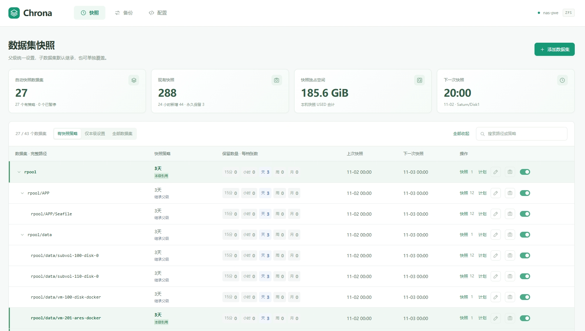
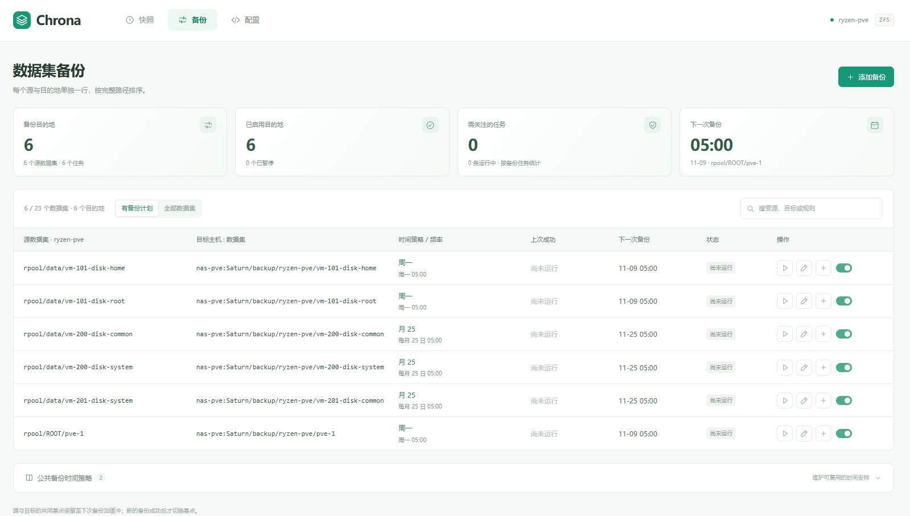

# Chrona

[English](README.md) · [简体中文](README.zh-CN.md)

A small, self-hosted Web UI for ZFS snapshots and backups. Run it on your NAS, set retention counts instead of writing cron expressions, and keep configuration in a plain YAML file.

Chrona is one Go binary with an embedded HTML/CSS/JavaScript interface. It needs no database, Node.js runtime, container, or external CDN. YAML parsing is its only third-party Go dependency. The current Web interface is in Simplified Chinese.

## How it works

- **Snapshots turn counts into expiry times.** Each tier converts its interval × retention count into one `chrona:expires` timestamp (months follow the calendar). If several tiers coincide, one snapshot serves them all and takes the longest tier’s expiry. Cleanup checks that timestamp, with `keep` and protected backup bases preserved.
- **Backups keep a shared stepping stone.** ZFS `send -i` sends changed blocks from a snapshot GUID shared by both ends. Each new backup snapshot expires at the next backup time + a buffer on both sides. Holds protect the previous base through delays or failures; only a verified success replaces it. Frequent local snapshots therefore do not break the incremental chain.

## What you can do

- **Snapshots:** see full dataset paths, policy names, retention counts, last snapshot and next run in one row. Browse snapshots, preview the schedule, edit rules, pause, or take a snapshot directly.
- **Policies:** set counts for 15-minute, hourly, daily, weekly and monthly tiers. New rules start at zero. Children inherit the nearest parent’s snapshot policy unless explicitly overridden.
- **Backups:** use a sorted, flat list with one row per source/destination pair. See both paths, rule, last success, next run and status; enable or pause each destination independently. Only leaf datasets are backed up, with no backup inheritance.
- **Overview:** read snapshot space usage and task summaries from the service’s existing cached inventory, without additional SSH calls.
- **Configuration:** edit or download the same YAML file from the UI. File changes reload automatically; invalid changes leave the working configuration intact.

## Screenshots

Snapshot policies, inherited rules and upcoming runs:



Each backup destination has its own target, timing policy and enable switch:



## Install a prebuilt Linux release

Download from [Releases](https://github.com/TheRainstorm/chrona/releases). Choose `amd64` for x86_64 or `arm64` for aarch64. Each archive includes the standalone binary, systemd unit, example configuration, documentation and license. The target needs Linux, OpenZFS tools (`zfs`, `zpool`), systemd and an SSH client for remote backups; Go is not required.

```sh
chrona_version=0.11.1
chrona_arch=amd64                 # or arm64
chrona_archive="chrona_${chrona_version}_linux_${chrona_arch}.tar.gz"
chrona_url="https://github.com/TheRainstorm/chrona/releases/download/v${chrona_version}"
curl -fLO "$chrona_url/$chrona_archive" &&
curl -fLO "$chrona_url/SHA256SUMS" &&
sha256sum --ignore-missing -c SHA256SUMS &&
tar -xzf "$chrona_archive" &&
cd "chrona_${chrona_version}_linux_${chrona_arch}" &&
./chrona -version
```

For a private fork, use authenticated `gh release download` instead of unauthenticated `curl`. To try the downloaded binary with simulated data, run `./chrona -listen 127.0.0.1:8086` and open [localhost:8086](http://127.0.0.1:8086); Demo mode does not touch ZFS.

For the first systemd installation:

```sh
sudo install -d -m 755 "/opt/chrona/releases/$chrona_version"
sudo install -m 755 chrona "/opt/chrona/releases/$chrona_version/chrona"
sudo ln -sfn "/opt/chrona/releases/$chrona_version" /opt/chrona/current
sudo install -d -m 700 /etc/chrona /var/lib/chrona
sudo test -f /etc/chrona/config.yaml || sudo install -m 600 config.example.yaml /etc/chrona/config.yaml
sudoedit /etc/chrona/config.yaml
sudo sh -c 'umask 077; test -s /etc/chrona/web-password || openssl rand -hex 24 > /etc/chrona/web-password'
sudo install -m 644 chrona.service /etc/systemd/system/chrona.service
sudo systemctl daemon-reload
sudo systemctl enable --now chrona.service
```

Set your actual datasets and schedules before starting: the supplied [systemd unit](deploy/chrona.service) enables real snapshots, expiry cleanup and replication. Its default address is `127.0.0.1:8086`. To listen on a LAN address, put `CHRONA_LISTEN=192.168.1.10:8086` in `/etc/chrona/chrona.env` (substitute the server’s IP), then restart `chrona`. HTTPS can be provided by a reverse proxy.

Log in as **chrona**; read the generated password with `sudo cat /etc/chrona/web-password`. YAML lives in `/etc/chrona/config.yaml`, runtime state in `/var/lib/chrona/state.json`, and reusable SSH sockets in `/run/chrona/ssh`. The root service reads `/root/.ssh/config`; establish key-based access and verified host keys for each receiver. Check service logs with `sudo journalctl -u chrona -n 50 --no-pager`.

## Upgrade and rollback

Download and verify the new archive as above. From its extracted directory, after running backups finish:

```sh
chrona_previous=$(readlink -f /opt/chrona/current)
chrona_backup="/var/backups/chrona/$(date +%Y%m%d-%H%M%S)"
sudo systemctl stop chrona
sudo install -d -m 700 "$chrona_backup"
sudo cp -a /etc/chrona "$chrona_backup/config"
sudo cp -a /var/lib/chrona "$chrona_backup/state"
sudo install -d -m 755 "/opt/chrona/releases/$chrona_version"
sudo install -m 755 chrona "/opt/chrona/releases/$chrona_version/chrona"
sudo ln -sfn "/opt/chrona/releases/$chrona_version" /opt/chrona/current
sudo systemctl start chrona
sudo systemctl status chrona --no-pager
```

This replaces the binary while preserving configuration, credentials and service customizations. Keep the previous release. To roll the binary back:

```sh
sudo ln -sfn "$chrona_previous" /opt/chrona/current
sudo systemctl restart chrona
```

## Build from source

Requires Go 1.24 or newer:

```sh
git clone https://github.com/TheRainstorm/chrona.git
cd chrona
make build
./bin/chrona -listen 127.0.0.1:8086
```

Source builds use the same Demo mode by default. Direct `-mode zfs` execution remains read-only unless `-enable-zfs-writes` is supplied. Use separate state files for Demo and ZFS modes.

## Retention, without cron

Set an anchor time and the number of snapshots to keep at each tier. For example:

```yaml
version: 3
timezone: UTC
jitter_seconds: 30
policies: []
datasets:
  - name: tank/data
    snapshot:
      start_at: "2026-01-01T00:00:00Z"
      keep: {quarter_hourly: 0, hourly: 3, daily: 7, weekly: 4, monthly: 12}
backups: []
```

A zero count disables that tier. A longer tier must cover at least as much history as a shorter tier. When tiers coincide, Chrona creates one snapshot using the longest tier’s expiry. A stable jitter spreads work out, and monthly schedules follow the calendar. See the example configuration for shared policy references and backup plans.

Expiry rules also cover existing snapshots:

- A snapshot suffix containing `keep`, in any letter case, is retained indefinitely. Only the part after `@` is checked; this overrides a finite expiry property.
- Otherwise, a valid `chrona:expires` Unix timestamp is respected, including on snapshots created by other tools.
- Without a valid explicit expiry, the default is **creation time + 30 days**. This is calculated without rewriting legacy snapshot properties.

Cleanup runs after snapshot creation, successful replication, or the initial receiver check, within that exact dataset. Holds and recorded incremental bases are protected; before the first transfer, existing receivers are checked in the background and their shared base is held. An unreachable receiver or unfinished receive temporarily defers source cleanup; pending checks retry every 15 minutes without adding SSH calls to page refreshes. Deletion rechecks snapshot identity, expiry and holds, and never uses recursive or forced deletion.

## Native replication

Backups use ZFS send/receive, locally across pools or through an SSH host alias such as `backup-nas`. The service uses its account’s SSH keys/configuration and verified host keys, with connection reuse. Use `host: local` for a local receiver.

Enter an SSH alias such as `nas-pve` and leave the port blank to use `~/.ssh/config`, including its `HostName`, `User`, `Port` and `IdentityFile`. With the supplied root systemd service, that file is `/root/.ssh/config` on the machine running Chrona. Direct hosts such as `backup.example.com:2202` or `user@backup.example.com:2202` are also supported. An explicit port overrides the SSH configuration; when neither specifies one, OpenSSH uses port 22.

Public `backup_policies` define timing only. Each `backups` entry chooses its own `host`, optional `port`, destination datasets and `policy` reference, so one schedule can serve local and remote targets. Select **Custom timing** for a schedule used only by that backup. Older combined rules migrate in memory without changing task IDs or incremental bases; saving writes the separated format.

The weekly/monthly frequency controls **when a backup runs**. Backup snapshots have no weekly/monthly retention counts: each run creates a dedicated snapshot with the same expiry at both ends, **next scheduled backup + `grace_minutes`** (default 60 minutes). This is separate from dataset snapshot retention. Removing retention counts does not shorten existing snapshot expiries; obsolete `keep_weekly` / `keep_monthly` config keys are accepted but ignored and omitted on the next save.

The core commands are `zfs send -w -p -i BASE NEW | zfs receive -u -s DEST`, with `-i BASE` omitted for the first full transfer. Each leaf dataset is transferred independently, without `-R`, intermediate-snapshot `-I`, or forced-receive `-F`.

Incremental transfers require the receiver’s latest snapshot GUID to exist at the source. Chrona protects both ends through the next backup plus a buffer, advances the base only after successful verification, and supports interrupted receive resumption. Existing destinations are never forcibly rolled back to make a transfer fit. New receiving datasets are left unmounted and read-only.

## CI and releases

GitHub Actions tests pull requests and `main` pushes, then cross-compiles static Linux `amd64` and `arm64` binaries. Pushing a `v*` version tag runs the checks and publishes both archives with `SHA256SUMS` to GitHub Releases. Each package records its version, commit and Go toolchain in `BUILDINFO.txt`; `chrona -version` reports the running build. CI publishes release files; updating a server remains an explicit deployment step.

From a source checkout, to produce the same packages locally, run `./scripts/release.sh v0.11.1`; output is written to `dist/`. The release build uses `CGO_ENABLED=0`, so it needs no external C runtime.

## Development

Run `make test` for Go tests and `node --check web/app.js` for JavaScript syntax. [scripts/browser-smoke.cjs](https://github.com/TheRainstorm/chrona/blob/main/scripts/browser-smoke.cjs) exercises an isolated Demo using Playwright; it changes demo configuration and must not target production. Rebuild after changing Go or embedded Web assets; YAML edits need no rebuild.

## License

[MIT](LICENSE) © 2026 Fuyan Yuan.
