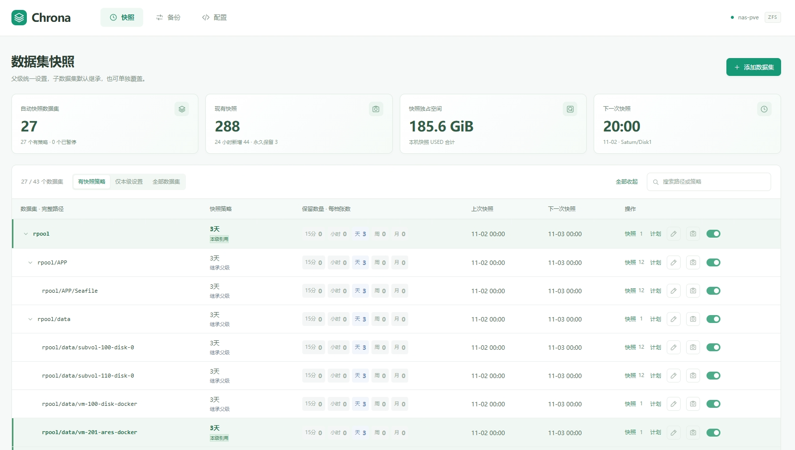
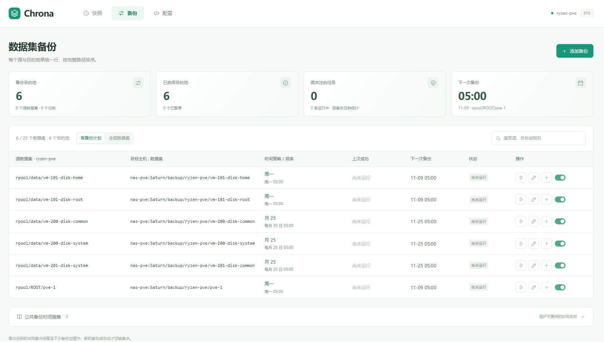

# Chrona

[English](README.md) · [简体中文](README.zh-CN.md)

一个轻量、可自行部署的 ZFS 快照与备份 Web 管理器。直接运行在 NAS 上，用各档保留数量代替繁琐的 cron 表达式，所有配置保存在一份普通 YAML 文件里。

Chrona 是一个 Go 可执行文件，内置 HTML/CSS/JavaScript 界面，无需数据库、Node.js 运行时、容器或外部 CDN。唯一的第三方 Go 依赖是 YAML 解析器，目前 Web 界面使用简体中文。

## 能做什么

- **快照管理**：一行显示完整数据集路径、策略名、各档保留数量、上次快照和下次时间，直接查看历史、预览计划、编辑、暂停或创建快照。
- **策略管理**：支持 15 分钟、小时、天、周、月五档，新建策略的数量全部默认为 0。子数据集默认继承最近父级的快照策略，也可以在本级覆盖。
- **备份管理**：按路径排序，每个源和目的地单独一行，展示完整路径、规则、上次成功、下次时间和状态；每个目的地都有独立启用开关。只有叶子数据集执行备份，备份没有继承关系。
- **概览**：展示快照占用和任务摘要，复用服务已有的缓存清单，不额外调用 SSH。
- **文件配置**：在界面编辑或下载同一份 YAML，也可以直接修改文件并自动重载；无效配置不会替换正在使用的有效配置。

## 界面预览

快照页面展示策略、继承关系、保留数量和下次执行时间：



备份页面每个目的地独立一行，分别设置目标、时间策略和启用状态：



## 先试用 Demo

需要 Go 1.24 或更新版本：

```sh
git clone https://github.com/TheRainstorm/chrona.git
cd chrona
go run ./cmd/chrona -listen 127.0.0.1:8086
```

打开 [localhost:8086](http://127.0.0.1:8086)。Demo 使用模拟数据，不操作真实 ZFS。首次运行会在 `data/` 下生成配置和演示状态。

使用 `make build` 构建独立程序，或运行：

```sh
CGO_ENABLED=0 go build -trimpath -o bin/chrona ./cmd/chrona
```

## 接入真实 ZFS

使用安装了 OpenZFS 工具（`zfs`、`zpool`）的 Linux 主机，并让运行账号拥有目标数据集的管理权限。先参考 [config.example.yaml](config.example.yaml)，填写自己的数据集和策略：

```sh
sudo install -d -m 700 /etc/chrona /var/lib/chrona
sudo install -m 600 config.example.yaml /etc/chrona/config.yaml
sudoedit /etc/chrona/config.yaml
sudo ./bin/chrona -mode zfs -listen 127.0.0.1:8086 \
  -config /etc/chrona/config.yaml -state /var/lib/chrona/state.json
```

ZFS 模式**默认只读**。加入 `-enable-zfs-writes` 后才启用自动快照、到期清理和复制。真实模式应使用独立的状态文件，不要复用 Demo 状态。

常用选项：

| 选项 | 用途 |
| --- | --- |
| `-auth-file /etc/chrona/web-password` | 启用 HTTP Basic 认证；账号为 `chrona`，从文件读取至少 20 个字符的密码。 |
| `-ssh-control-dir /run/chrona/ssh` | 复用 SSH 连接，执行远端查询和传输。 |
| `-listen 127.0.0.1:8086` | 设置监听地址；远程访问可通过反向代理提供 HTTPS。 |

需要开机启动时，按实际程序位置、路径和监听地址调整 [chrona.service.example](chrona.service.example)。每份配置只运行一个服务实例。

## 不写 cron，只设保留数量

定义一个起始时间，再填写每档保留数量。例如：

```yaml
version: 3
timezone: UTC
jitter_seconds: 30
policies: []
datasets:
  - name: tank/data
    snapshot:
      start_at: "2026-01-01T00:00:00Z"
      keep: {quarter_hourly: 0, hourly: 3, daily: 7, weekly: 4, monthly: 12}
backups: []
```

数量为 0 表示关闭该档。较长档位的保留总跨度不能小于较短档位；多档同时触发时只创建一张快照，由最长档决定到期时间。稳定的随机偏移会分散执行时间，月档按真实日历计算。公共策略引用和备份计划的完整格式见示例配置。

已有快照也采用统一的到期规则：

- 快照名称的 `@` 后缀含 `keep` 时永久保留，不区分大小写，并且优先于已有的有限到期属性。数据集路径中的 `keep` 不影响判断。
- 其他快照如果有有效的 `chrona:expires` Unix 时间戳，就遵守这个期限，包括其他工具创建的快照。
- 没有有效到期属性时，默认按**创建时间加 30 天**计算，无需批量改写旧快照的属性。

清理只在成功创建快照或完成复制后处理当前精确数据集。已有 hold 和记录中的增量基点受保护；尚未确认共同基点的备份源会暂缓清理。删除前重新核对快照身份、期限和 hold，不递归、不强制删除。

## 原生增量备份

通过 ZFS send/receive 进行本机跨池复制，或使用 `backup-nas` 这样的 SSH 主机别名传到远端。程序使用运行账号的 SSH 密钥、配置和已验证的主机密钥，并复用连接。本机目的地可设置 `host: local`。

主机填 `nas-pve` 这样的 SSH 别名，端口留空，即使用 `~/.ssh/config` 中的 `HostName`、`User`、`Port` 和 `IdentityFile`。使用提供的 root systemd 服务时，配置文件位于运行 Chrona 的机器上的 `/root/.ssh/config`。也可以直接填写 `backup.example.com:2202` 或 `user@backup.example.com:2202`。显式填写的端口优先于 SSH 配置；两者都没有指定时，OpenSSH 默认使用 22。

公共 `backup_policies` 只定义时间。每条 `backups` 独立设置目标 `host`、可选的 `port`、数据集路径与 `policy` 引用，同一个时间策略可以用于本机和不同远端。选择“自定义时间”可以单独设置这条备份的时间。旧的组合规则会在内存中拆分，任务 ID 和增量基点保持不变；保存时写入新格式。

每周／每月频率只决定**何时执行备份**。备份不再设置周档、月档保留数量：每次新建专用快照，两端到期时间统一为**下一次备份时间 + `grace_minutes`**，默认缓冲 60 分钟，与数据集快照保留策略独立。已有快照期限不会因移除保留数量而缩短；旧配置的 `keep_weekly` / `keep_monthly` 兼容读取但不再生效，下次保存时移除。

核心命令是 `zfs send -w -p -i BASE NEW | zfs receive -u -s DEST`，首次全量省略 `-i BASE`。逐个复制叶子数据集，不使用递归的 `-R`、携带中间快照的 `-I` 或强制接收的 `-F`。

增量传输要求接收端最新快照的 GUID 在源端存在。两端基点至少保留到下次备份加缓冲时间，验证成功后才推进基点；中断传输支持续传。不会为了传输而强制回滚已有目的地，新接收的数据集保持未挂载和只读。

## 开发

运行 `make test` 执行 Go 测试，`node --check web/app.js` 检查 JavaScript 语法。[scripts/browser-smoke.cjs](scripts/browser-smoke.cjs) 使用 Playwright 验证独立 Demo，会修改演示配置，不能指向生产服务。修改 Go 或内置 Web 文件后需要重新构建；修改 YAML 不需要。

## 许可证

[MIT](LICENSE) © 2026 Fuyan Yuan。
